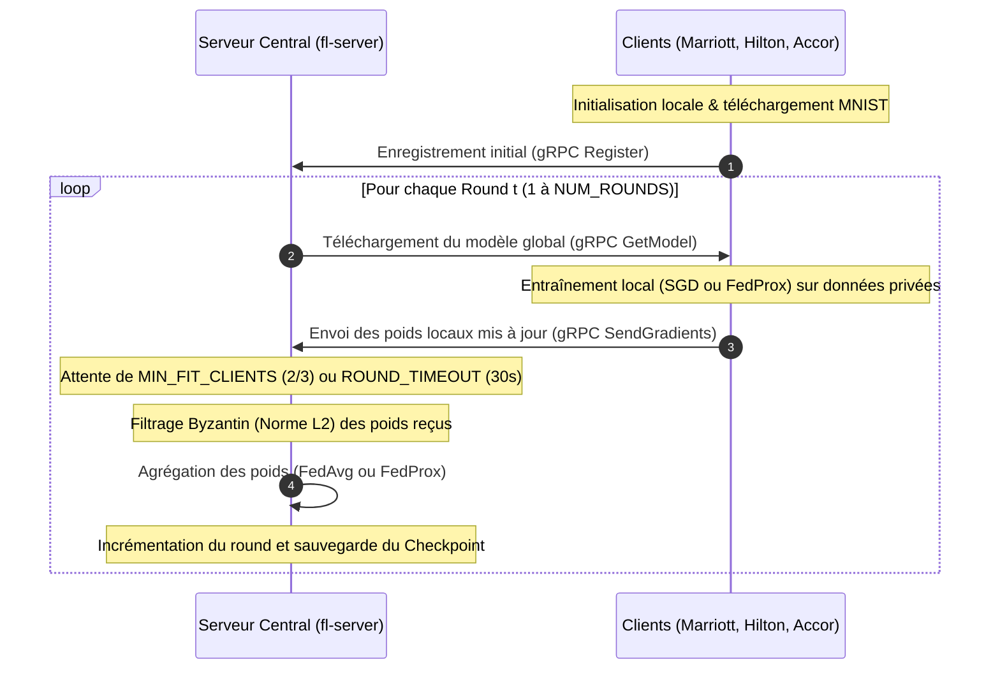

# Rapport Académique & Technique : Analyse Distribuée Globale (Federated Learning Hôtellerie)

## EMSI — Projet Systèmes Distribués 2025-2026
### Équipe : Wiame El Hernoussi, Marwa Harbal, Doha Bouthir

---

## 1. Processus Global et Flux de Communication

Le projet implémente un système d'**Apprentissage Fédéré (Federated Learning)** appliqué au secteur hôtelier (Marriott, Hilton, Accor). Le concept fondamental est d'entraîner un modèle d'apprentissage profond global sans jamais centraliser les données privées des clients, préservant ainsi la confidentialité.

### Le Cycle d'Entraînement Fédéré (Spoke-and-Hub)
Le processus se déroule en plusieurs étapes itératives appelées **Rounds** :



---

## 2. Architecture Logicielle : Multi-couche vs Multi-niveaux (N-Tier)

Il est crucial de distinguer ces deux concepts d'architecture. Notre projet applique les deux de manière complémentaire :

### A. Une Architecture Multi-niveaux (N-Tier) — Physique
L'architecture est **physiquement découplée en 3 tiers (N-Tier)** distincts s'exécutant dans des environnements d'exécution séparés (les conteneurs Docker) et communiquant uniquement via le réseau :
1.  **Tier 1 (Présentation)** : Les tableaux de bord HTML5/JS/Chart.js ([fl-dashboard](./dashboard/index.html) et [hotel_dashboard.html](./client/hotel_dashboard.html)) qui s'exécutent directement dans le **navigateur web** de l'utilisateur final.
2.  **Tier 2 (Logique Applicative / Traitement)** : Les conteneurs Python exécutant le serveur de coordination ([server.py](./server/server.py)) et les clients d'apprentissage ([client.py](./client/client.py)).
3.  **Tier 3 (Accès aux Données)** : Les partitions locales de données MNIST stockées sur le disque virtuel de chaque conteneur client (`./data`), assurant un partitionnement strict.

> [!IMPORTANT]
> **Justification du N-Tier :** Ce découplage garantit la sécurité et l'extensibilité. Les clients (hôtels) ne peuvent pas accéder directement à la logique interne du serveur ni aux données des autres hôtels, et l'interface utilisateur (Tier 1) n'a pas accès direct aux fichiers de données (Tier 3).

### B. Une Architecture Multi-couche (Multi-layer) — Logique
À l'intérieur de chaque conteneur, le code respecte une séparation logique en couches :
*   **Couche Contrôleur / Exposition (API)** : Gérée par [api.py](./server/api.py) (serveur) et [hotel_api.py](./client/hotel_api.py) (client) via Flask.
*   **Couche Service / Logique Métier** : Implémentée dans [aggregator.py](./server/aggregator.py) (calcul de FedAvg) et [client.py](./client/client.py) (orchestration FL).
*   **Couche Modèle (Domain)** : Définie dans [model.py](./client/model.py) avec le réseau neuronal `SimpleCNN`.
*   **Couche Repository / Data Access** : Implémentée dans [data_loader.py](./client/data_loader.py) pour charger et découper les lots de données.

---

## 3. Le Concept de RPC (Remote Procedure Call) : gRPC vs CORBA

### A. Pourquoi gRPC est-il appliqué dans ce projet ?
Le concept de **RPC (Remote Procedure Call)** est massivement appliqué dans la communication critique du Federated Learning (liaison client-serveur). Nous utilisons spécifiquement **gRPC** (développé par Google).
*   **Où :** Défini dans le contrat d'interface [fl.proto](./shared/fl.proto), compilé en Python, et exécuté dans le canal réseau TCP sur le port `50051`.
*   **Pourquoi :** 
    1.  **Performance binaire :** Contrairement à REST (JSON textuel lourd), gRPC utilise **Protocol Buffers** pour sérialiser les données dans un format binaire compressé extrêmement compact. C'est capital pour transférer des centaines de milliers de poids réels (`float32`) de réseaux de neurones.
    2.  **HTTP/2 :** Il permet le multiplexage de requêtes sur une seule connexion TCP et réduit considérablement la latence.
    3.  **Contrat strict (IDL) :** Le fichier `.proto` sert de contrat immuable entre le serveur et les clients.

### B. Pourquoi pas CORBA ?
Le protocole **CORBA** (Common Object Request Broker Architecture) est une technologie RPC historique (populaire dans les années 90) qui n'est **pas** appliquée ici. 
*   **Raison :** CORBA souffre d'une complexité d'implémentation légendaire (lenteur d'exécution, spécifications surchargées, poids du protocole GIOP/IIOP, manque d'adaptation aux architectures cloud modernes). gRPC a complètement supplanté CORBA grâce à sa légèreté, son support natif de HTTP/2 et sa génération de code simple et moderne.

---

## 4. Synchronisation des Horloges : Physiques vs Logiques

### A. L'insuffisance des Horloges Physiques et NTP
Dans un système distribué réel, chaque conteneur Docker possède sa propre horloge physique. 
*   **Dérive (Clock Drift) :** Les quartz des serveurs physiques dérivent naturellement à cause de la température et de l'usure, créant un décalage (skew).
*   **Le Protocole NTP (Network Time Protocol) :** NTP résout cela en synchronisant les horloges via une hiérarchie de serveurs temporels appelés **Stratums** (Stratum 0 = horloge atomique, Stratum 1 = serveurs synchronisés directement, Stratum 2 = serveurs synchronisés sur Stratum 1). 
*   **Pourquoi NTP ne suffit pas :** Même avec NTP, la synchronisation parfaite à la milliseconde près est impossible sur un réseau à cause de la latence asymétrique. On ne peut pas utiliser l'heure physique pour ordonner avec certitude deux événements distribués (ex: savoir si l'enregistrement de Marriott s'est réellement produit avant ou après celui d'Accor).

### B. Solution Appliquée : L'Horloge Logique de Lamport
Pour garantir un ordonnancement causal strict sans dépendre du temps physique, nous implémentons l'**Horloge Logique de Lamport** (1978).
*   **Où :** Dans [lamport_clock.py](./server/lamport_clock.py) sur le serveur, et synchronisé dans chaque message gRPC défini par [fl.proto](./shared/fl.proto) (`int64 lamport_time`).
*   **Règles appliquées :**
    1.  **Événement local (ex: début d'entraînement) :** $L = L + 1$
    2.  **Envoi d'un message :** Le client ou serveur attache sa valeur actuelle $L$ au message.
    3.  **Réception d'un message avec timestamp $T$ :** Le récepteur met à jour son horloge : $L = \max(L, T) + 1$.

#### Exemple concret de trace d'exécution Lamport :
```text
1. [SERVEUR]  Initialisation à L=0
2. [CLIENT 0] Init à L=0. Déclenche Register() -> L=1. Envoie (L=1)
3. [SERVEUR]  Reçoit Register. L_serveur = max(0, 1) + 1 = 2. [Log: Client 0 enregistré à t=2]
4. [CLIENT 1] Init à L=0. Déclenche Register() -> L=1. Envoie (L=1)
5. [SERVEUR]  Reçoit Register. L_serveur = max(2, 1) + 1 = 3. [Log: Client 1 enregistré à t=3]
6. [SERVEUR]  Envoie le modèle à Client 0. L_serveur passe à 4. Envoie (L=4)
7. [CLIENT 0] Reçoit le modèle. L_client0 = max(1, 4) + 1 = 5.
```
Ce mécanisme garantit une **relation causale (Happens-Before)** parfaite entre les étapes.

---

## 5. Algorithmique Distribuée : Chandy-Lamport et Ordonnancement

### A. Algorithme de Chandy-Lamport (Distributed Snapshot)
L'algorithme classique de Chandy-Lamport sert à enregistrer un **état global cohérent** (snapshot) d'un système distribué sans arrêter son exécution, en faisant circuler des marqueurs (markers) sur des canaux de communication FIFO.
*   **Application dans le projet :** Nous implémentons une version simplifiée et adaptée à l'apprentissage fédéré. Le Federated Learning agit naturellement comme une **barrière de synchronisation synchrone**. À la fin de chaque round d'agrégation, le serveur fige l'état global et l'enregistre sur disque dans `round_state.json` (checkpoint).
*   **Pourquoi ?** Si le serveur ou un client crashe au milieu du round $t$, le système peut redémarrer et recharger l'état cohérent du round $t-1$ à partir du fichier de sauvegarde.

### B. Sémantiques d'Ordonnancement de Messages
*   **FIFO (First-In, First-Out) :** Appliqué nativement. Comme gRPC s'appuie sur le protocole de transport **TCP**, la livraison des messages sur un canal point-à-point est strictement ordônée et FIFO.
*   **Ordonnancement Causal :** Garanti par l'intégration des horloges logiques de Lamport dans chaque échange gRPC.
*   **Ordonnancement Total (Total Order) :** Dans notre architecture centralisée, le serveur central `fl-server` sert de **séquenceur central**. Il impose un ordonnancement total des rounds et des poids à l'ensemble du réseau en agissant comme l'unique autorité de décision.

---

## 6. Services Web et Concept REST

Bien que la boucle d'apprentissage lourd utilise gRPC pour des raisons de performance, le système applique l'architecture **REST (Representational State Transfer)** pour tout ce qui concerne le monitoring, l'analyse et la visualisation.

### A. Exposition et API REST
*   **Où :** Implémenté dans [api.py](./server/api.py) (serveur) et [hotel_api.py](./client/hotel_api.py) (client).
*   **Ressources et URIs (Uniform Resource Identifiers) :**
    *   `GET /metrics` : Représente la ressource "état des métriques globales" (round en cours, taux de perte réseau, accuracy, horloge Lamport).
    *   `GET /status` : Représente la ressource "état de santé des clients".
    *   `GET /history` : Représente l'historique complet des performances sous forme de données tabulaires (CSV).
    *   `POST /predict` : Ressource côté client pour soumettre une prédiction d'annulation de réservation en temps réel.
*   **Pourquoi REST ?** REST est standardisé, léger, stateless, et nativement compatible avec le protocole HTTP classique des navigateurs web, ce qui facilite l'intégration directe des graphes JS.

### B. Découpage Microservices & Service Discovery
1.  **Architecture Microservices :** Chaque composant (le serveur, les 3 clients hôteliers, et le dashboard global) est développé comme un microservice indépendant, isolé dans son propre conteneur avec ses propres dépendances technologiques (Node.js pour le dashboard, Python pour le reste).
2.  **Service Discovery (Découverte de services) :** Dans un environnement distribué, les IPs des conteneurs changent dynamiquement. Pour éviter d'écrire des adresses IP en dur, nous utilisons le **DNS interne de Docker Compose**. Le client résout automatiquement l'adresse du serveur en interrogeant le nom logique `fl-server:50051`.
3.  **API Gateway :** Pour ce projet de taille académique, il n'y a pas de passerelle complexe (comme Kong ou Nginx), mais le serveur centralisé `fl-server` centralise les flux de données et agit comme point d'entrée API unique pour collecter les métriques du système.

---

## 7. Modèle Temporel et Latence Bornée

### A. Modèle de Système : Partiellement Synchrone (Borné Synchrone)
Notre système distribué n'est pas purement asynchrone (ce qui rendrait le consensus impossible selon le théorème FLP), mais **partiellement synchrone** grâce à des hypothèses de **latence bornée** :
*   **Heartbeats (5s) :** Chaque client envoie un signal de vie toutes les 5 secondes au serveur.
*   **Fault Detection Timeout (15s) :** Si un client ne répond pas pendant 15 secondes, la latence est considérée comme dépassée (panne réseau ou crash) et il est déclaré `INACTIVE` par le [fault_detector.py](./server/fault_detector.py).
*   **Round Timeout (30s) :** Lors de l'agrégation, si un client met plus de 30 secondes à renvoyer ses gradients, le serveur avance sans lui pour éviter de bloquer l'apprentissage global.
*   **Exponential Backoff avec Jitter :** En cas d'erreur de communication gRPC ou de perte réseau temporaire, le client n'inonde pas le réseau. Il applique un délai exponentiel aléatoire : $\text{délai} = \min(60, 2^n) + \text{random}(0, 1)$ pour retenter la connexion.

### B. Pourquoi pas GraphQL ou MCP (Model Context Protocol) ?
*   **GraphQL** (qui permet des requêtes personnalisées) et **MCP** (Model Context Protocol pour les agents IA) ne sont **pas** appliqués ici. 
*   **Raison :** GraphQL rajouterait une surcouche de parsing inutile sur le serveur pour des structures de données fixes et statiques (on sait exactement quelles métriques on veut). gRPC pour l'apprentissage et REST pour le monitoring offrent le meilleur compromis simplicité/performance.

---

## 8. Modèle de Fautes, Sûreté, Vivacité et Consensus

Un système distribué doit être robuste face aux pannes. Notre projet implémente des mécanismes avancés pour garantir ces propriétés.

### A. Propriétés de Sûreté (Safety) et de Vivacité (Liveness)
*   **Sûreté (Safety — "Rien de mauvais n'arrive") :**
    1.  **Filtrage Byzantin :** Un client malveillant ou défaillant (byzantin) pourrait injecter des poids aberrants pour corrompre le modèle global. Dans [aggregator.py](./server/aggregator.py), nous calculons la norme L2 des poids reçus. Si la norme d'un client dépasse **10 fois la médiane** des autres, il est automatiquement exclu de l'agrégation.
    2.  **Confidentialité Différentielle (Differential Privacy) :** Injection optionnelle de bruit gaussien sur les poids locaux pour empêcher toute attaque par reconstruction de données privées.
*   **Vivacité (Liveness — "Quelque chose de bien finira par arriver") :**
    *   Même si 1 hôtel sur les 3 subit un crash complet, le système garantit que l'apprentissage progresse car `MIN_FIT_CLIENTS=2` permet de continuer l'agrégation avec les 2 survivants.

### B. Modèle et Hiérarchie des Fautes
Notre système tolère et catégorise plusieurs types de fautes :

| Type de Faute | Description | Comment le projet la gère et la tolère |
| :--- | :--- | :--- |
| **Crash-Stop (Arrêt franc)** | Un conteneur client s'arrête (`docker stop`). | Détecté par le `FaultDetector` en 15s. Retiré du pool actif. |
| **Crash-Recovery (Panne avec reprise)** | Un client redémarre après un crash. | Le client s'enregistre à nouveau. Il récupère le modèle global à jour au round actuel via `GetModel` et réintègre la boucle. |
| **Faute d'Omission (Perte réseau)** | Des messages gRPC ou REST sont perdus en route. | Gérée par le `NetworkSimulator` qui simule jusqu'à 30% de perte. Tolérée côté client grâce à **l'Exponential Backoff** et côté serveur grâce au **Round Timeout**. |
| **Faute Byzantine (Arbitraire / Malveillante)** | Un client corrompt volontairement ses poids d'apprentissage. | Détectée et tolérée grâce au **Byzantine Filter** qui exclut les anomalies basées sur la norme L2. |

### C. Sémantique de Livraison des Messages
Pour garantir la robustesse des échanges, le système applique une sémantique **At-Least-Once (Au moins une fois)** au niveau applicatif pour les fonctions clés comme l'enregistrement ou la mise à jour des poids. Si un message est perdu ou expiré, le client réémet sa requête jusqu'à obtenir un acquittement du serveur.

### D. Consensus Distribué
Le Federated Learning est intrinsèquement un problème de **consensus** : tous les nœuds doivent se mettre d'accord sur une unique version finale des poids du modèle global.
*   **Type de Consensus :** Le consensus est ici **centralisé (Coordonné)**. Le serveur `fl-server` fait office d'autorité centrale (Leader). Il récolte les avis (gradients locaux), calcule le compromis optimal via l'algorithme d'agrégation (**FedAvg** ou **FedProx**), et diffuse la décision finale à tous les membres.
*   **Pourquoi pas Paxos ou Raft ?** Les algorithmes de consensus décentralisés comme Raft ou Paxos servent à élire un leader ou à répliquer un journal de transactions de manière cohérente en cas de panne du leader lui-même. Dans notre architecture d'apprentissage fédéré, la centralisation de l'agrégateur est acceptée et gérée (si le serveur tombe, les clients attendent sa reprise, et le serveur recharge l'état cohérent via le checkpoint `round_state.json`).

---

## 9. Synthèse des protocoles et tolérances

| Concept Distribué | Appliqué ? | Fichier Source & Ligne Clé | Rôle et Utilité dans le Projet |
| :--- | :--- | :--- | :--- |
| **Architecture N-Tier** | ✅ Oui | [docker-compose.yml](./docker-compose.yml) | Séparer physiquement les conteneurs (dashboard, clients, serveur, données) pour la sécurité. |
| **RPC / gRPC** | ✅ Oui | [fl.proto](./shared/fl.proto) & [server.py](./server/server.py#L90) | Permettre des appels de fonctions à distance rapides et compresser le transfert des poids de modèle en binaire. |
| **CORBA** | ❌ Non | *Aucun* | Remplacé par gRPC, car trop lourd et obsolète pour les architectures modernes. |
| **NTP & Horloge Physique**| ⚠️ Partiel | Géré par l'OS hôte | Utile pour la synchronisation grossière, mais insuffisante pour la causalité réseau. |
| **Horloge de Lamport** | ✅ Oui | [lamport_clock.py](./server/lamport_clock.py#L7) | Assurer un ordonnancement causal logique ($L = \max(L, T) + 1$) pour suivre les événements FL. |
| **Chandy-Lamport (Snapshot)**| ⚠️ Simplifié | [server.py](./server/server.py#L182) | Sauvegarde d'un état global cohérent (`round_state.json`) à la fin de chaque round d'apprentissage. |
| **REST (API & URIs)** | ✅ Oui | [api.py](./server/api.py#L12) & [hotel_api.py](./client/hotel_api.py#L15) | Fournir des routes de monitoring standardisées (`/metrics`, `/status`) lisibles par les navigateurs. |
| **Service Discovery** | ✅ Oui | [docker-compose.yml](./docker-compose.yml#L52) | Résolution automatique du serveur par DNS interne Docker via son nom de service `fl-server`. |
| **Latence Bornée (Timeouts)**| ✅ Oui | [server.py](./server/server.py#L40) & [fault_detector.py](./server/fault_detector.py#L8) | Détecter les pannes réseau en 15s (Heartbeat) et éviter les blocages de rounds d'apprentissage (Timeout 30s). |
| **Filtrage Byzantin** | ✅ Oui | [aggregator.py](./server/aggregator.py#L10) | Détecter et éliminer les clients défaillants ou malveillants injectant des poids anormaux (Norme L2). |
| **Consensus Centralisé** | ✅ Oui | [aggregator.py](./server/aggregator.py#L30) | Permettre aux 3 hôtels d'atteindre un accord sur les poids du réseau neuronal via **FedAvg** / **FedProx**. |

