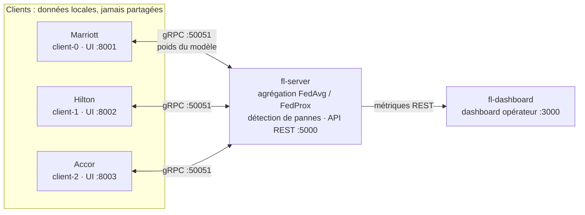

# Federated Learning pour l'hôtellerie

Système d'**apprentissage fédéré distribué** : trois hôtels (Marriott, Hilton, Accor) entraînent ensemble un modèle de deep learning **sans jamais partager leurs données brutes**. Un serveur central agrège uniquement les poids des modèles.


> Projet académique, EMSI, module Systèmes Distribués 2025-2026.

---

## Ce que ce projet démontre

- **Communication distribuée** par gRPC et Protocol Buffers entre un serveur et plusieurs clients (`shared/fl.proto`).
- **Agrégation fédérée** : FedAvg et FedProx, avec filtrage des clients byzantins.
- **Concepts de systèmes distribués** : horloges logiques de Lamport, détection de pannes par heartbeat, reprise sur panne, checkpoint en cours de round, simulation de pertes de messages.
- **Confidentialité** : les données restent chez chaque client, avec une option de confidentialité différentielle.
- **Déploiement conteneurisé** : 5 services orchestrés avec Docker Compose.
- **Observabilité** : un dashboard opérateur et une interface web par hôtel.

## Architecture



| Service | Rôle |
|---|---|
| `fl-server` | Coordonne les rounds, agrège les poids, détecte les pannes, expose une API REST |
| `fl-client-0/1/2` | Entraînement local par hôtel et interface web de prédiction |
| `fl-dashboard` | Courbes d'accuracy et de loss (IID vs Non-IID), statut des clients |

Un cycle d'entraînement (un *round*) se déroule ainsi : chaque client récupère le modèle global, l'entraîne sur ses données locales, renvoie ses poids, puis le serveur les agrège dès que `MIN_FIT_CLIENTS` clients ont répondu (ou à l'expiration de `ROUND_TIMEOUT`). Le diagramme de séquence complet est dans [DISTRIBUTED_SYSTEMS.md](./DISTRIBUTED_SYSTEMS.md).

## Démarrage rapide

**Prérequis** : Docker et Docker Compose, 4 Go de RAM minimum, et une connexion internet. Au premier lancement, PyTorch CPU est installé pendant le build des images et MNIST est téléchargé.

```bash
git clone https://github.com/Wiameelhernoussi/federated-learning-hotel.git
cd federated-learning-hotel
docker compose up --build
```

L'entraînement démarre automatiquement dès que 2 clients sont enregistrés. Pour tout arrêter : `docker compose down -v`.

### Interfaces

| Interface | URL |
|---|---|
| Dashboard opérateur (IID vs Non-IID) | http://localhost:3000 |
| Interface Marriott / Hilton / Accor | http://localhost:8001/dashboard · :8002 · :8003 |
| API métriques | http://localhost:5000/metrics |
| Statut des clients | http://localhost:5000/status |
| Historique complet | http://localhost:5000/history |

## Algorithmes et mécanismes

| Mécanisme | Fichier | Description |
|---|---|---|
| FedAvg | `server/aggregator.py` | Moyenne pondérée des poids selon la taille des datasets |
| FedProx | `client/model.py` | Terme proximal pour limiter la dérive des clients en Non-IID |
| Filtrage byzantin | `server/aggregator.py` | Exclusion des clients dont la norme L2 dépasse 10× la médiane |
| Horloge de Lamport | `server/lamport_clock.py` | Ordonnancement logique des événements distribués |
| Détection de pannes | `server/fault_detector.py` | Heartbeat toutes les 5 s, client INACTIVE après 15 s |
| Checkpoint de round | `server/server.py` | Sauvegarde de l'état à chaque mise à jour reçue |
| Pertes de messages | `server/server.py` | Simulation configurable (`MESSAGE_LOSS_RATE`) |
| Confidentialité différentielle | `client/client.py` | Bruit gaussien sur les poids (désactivée par défaut) |
| Backoff exponentiel | `client/client.py` | Reconnexion avec délai croissant et jitter |

## Expériences reproductibles

**Mode Non-IID** (données hétérogènes entre hôtels) : dans `docker-compose.yml`, passer `RUN_MODE=non-iid` sur le serveur et `PARTITION_TYPE=non-iid` sur les 3 clients, puis `docker compose down -v && docker compose up --build`. Les courbes IID et Non-IID s'affichent côte à côte dans le dashboard.

**Panne d'un client** : pendant l'entraînement, `docker stop federated-learning-hotel-fl-client-2-1`. Accor passe INACTIVE en moins de 15 s et le serveur continue avec les 2 clients restants. Un `docker start` le réintègre.

**Pertes réseau** : régler `MESSAGE_LOSS_RATE=0.1` sur le serveur, puis suivre `docker compose logs fl-server | grep "NETWORK SIM"`.

Les scénarios de test détaillés se trouvent dans [DISTRIBUTED_SYSTEMS.md](./DISTRIBUTED_SYSTEMS.md).

## Structure du dépôt

```
.
├── shared/
│   └── fl.proto                # Contrat gRPC (service, messages, horloge de Lamport)
├── server/
│   ├── server.py               # Gestion des rounds, simulateur réseau, Lamport
│   ├── aggregator.py           # FedAvg, filtrage byzantin, métriques
│   ├── api.py                  # API REST Flask (métriques, statut, historique)
│   ├── lamport_clock.py        # Horloge logique thread-safe
│   └── fault_detector.py       # Détection de pannes par heartbeat
├── client/
│   ├── client.py               # Boucle d'entraînement fédéré
│   ├── model.py                # CNN, entraînement local, FedProx
│   ├── data_loader.py          # Partitionnement IID / Non-IID
│   ├── hotel_api.py            # API et interface de prédiction par hôtel
│   └── hotel_dashboard.html
├── dashboard/
│   └── index.html              # Dashboard opérateur (Chart.js)
├── docker-compose.yml          # Orchestration des 5 services
└── DISTRIBUTED_SYSTEMS.md      # Analyse : architecture, RPC, horloges, CAP, pannes
```

## À propos des données

Le pipeline fédéré est entraîné et validé sur **MNIST**, benchmark standard de classification d'images. L'interface hôtelière illustre un cas d'usage de prédiction d'annulation : les champs d'une réservation sont encodés en entrée du modèle, et les classes 5 à 9 sont interprétées comme « risque élevé ». Il s'agit d'une **démonstration de l'architecture**, et non d'un modèle entraîné sur de vrais historiques de réservations. L'apport du projet est l'infrastructure distribuée.

## Documentation

[DISTRIBUTED_SYSTEMS.md](./DISTRIBUTED_SYSTEMS.md) analyse en profondeur les choix d'architecture : multi-niveaux contre multi-couches, gRPC contre CORBA, horloges logiques contre NTP, compromis CAP, gestion des pannes et des timeouts.

## Équipe

Wiame El Hernoussi · Marwa Harbal · Doha Bouthir

