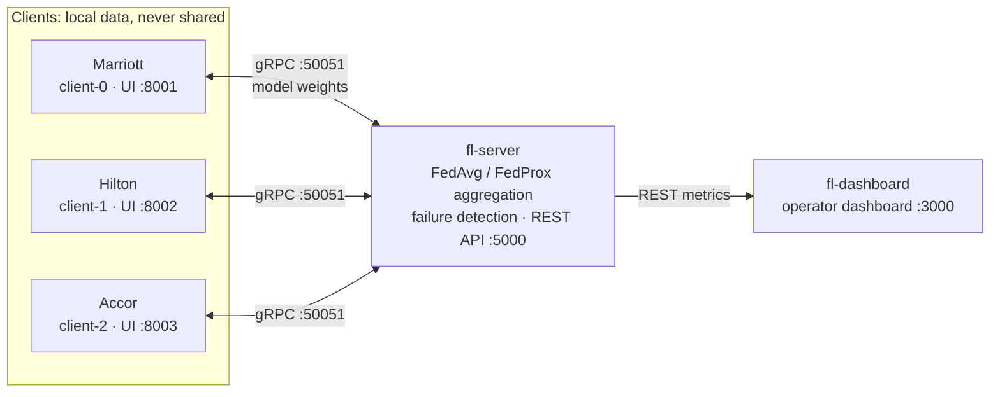

# Federated Learning for the Hospitality Industry

A **distributed federated learning system**: three hotels (Marriott, Hilton, Accor) jointly train a deep learning model **without ever sharing their raw data**. A central server only aggregates the model weights.


> Academic project, EMSI, Distributed Systems course 2025-2026.

---

## What this project demonstrates

- **Distributed communication** with gRPC and Protocol Buffers between a server and several clients (`shared/fl.proto`).
- **Federated aggregation**: FedAvg and FedProx, with Byzantine client filtering.
- **Distributed systems concepts**: Lamport logical clocks, heartbeat-based failure detection, crash recovery, mid-round checkpointing, message loss simulation.
- **Privacy**: data stays on each client, with an optional differential privacy mechanism.
- **Containerized deployment**: 5 services orchestrated with Docker Compose.
- **Observability**: an operator dashboard and a web interface for each hotel.

## Architecture



| Service | Role |
|---|---|
| `fl-server` | Coordinates rounds, aggregates weights, detects failures, exposes a REST API |
| `fl-client-0/1/2` | Local training for each hotel and a prediction web interface |
| `fl-dashboard` | Accuracy and loss curves (IID vs Non-IID), client status |

A training cycle (a *round*) works as follows: each client fetches the global model, trains it on its local data, sends back its weights, and the server aggregates them as soon as `MIN_FIT_CLIENTS` clients have responded (or when `ROUND_TIMEOUT` expires). The full sequence diagram is in [DISTRIBUTED_SYSTEMS.md](./DISTRIBUTED_SYSTEMS.md) (written in French).

## Quick start

**Requirements**: Docker and Docker Compose, at least 4 GB of RAM, and an internet connection. On first launch, PyTorch CPU is installed while the images are built and MNIST is downloaded.

```bash
git clone https://github.com/Wiameelhernoussi/federated-learning-hotel.git
cd federated-learning-hotel
docker compose up --build
```

Training starts automatically once 2 clients are registered. To stop everything: `docker compose down -v`.

### Interfaces

| Interface | URL |
|---|---|
| Operator dashboard (IID vs Non-IID) | http://localhost:3000 |
| Marriott / Hilton / Accor interface | http://localhost:8001/dashboard · :8002 · :8003 |
| Metrics API | http://localhost:5000/metrics |
| Client status | http://localhost:5000/status |
| Full history | http://localhost:5000/history |

## Algorithms and mechanisms

| Mechanism | File | Description |
|---|---|---|
| FedAvg | `server/aggregator.py` | Weighted average of the weights by dataset size |
| FedProx | `client/model.py` | Proximal term to limit client drift in Non-IID settings |
| Byzantine filtering | `server/aggregator.py` | Excludes clients whose L2 norm exceeds 10× the median |
| Lamport clock | `server/lamport_clock.py` | Logical ordering of distributed events |
| Failure detection | `server/fault_detector.py` | Heartbeat every 5 s, client marked INACTIVE after 15 s |
| Round checkpoint | `server/server.py` | State saved on every update received |
| Message loss | `server/server.py` | Configurable simulation (`MESSAGE_LOSS_RATE`) |
| Differential privacy | `client/client.py` | Gaussian noise added to the weights (disabled by default) |
| Exponential backoff | `client/client.py` | Reconnection with increasing delay and jitter |

## Reproducible experiments

**Non-IID mode** (heterogeneous data across hotels): in `docker-compose.yml`, set `RUN_MODE=non-iid` on the server and `PARTITION_TYPE=non-iid` on the 3 clients, then run `docker compose down -v && docker compose up --build`. The IID and Non-IID curves appear side by side in the dashboard.

**Client failure**: during training, run `docker stop federated-learning-hotel-fl-client-2-1`. Accor becomes INACTIVE in under 15 s and the server keeps going with the 2 remaining clients. A `docker start` brings it back.

**Network loss**: set `MESSAGE_LOSS_RATE=0.1` on the server, then follow `docker compose logs fl-server | grep "NETWORK SIM"`.

Detailed test scenarios are described in [DISTRIBUTED_SYSTEMS.md](./DISTRIBUTED_SYSTEMS.md).

## Repository structure

```
.
├── shared/
│   └── fl.proto                # gRPC contract (service, messages, Lamport clock)
├── server/
│   ├── server.py               # Round management, network simulator, Lamport
│   ├── aggregator.py           # FedAvg, Byzantine filtering, metrics
│   ├── api.py                  # Flask REST API (metrics, status, history)
│   ├── lamport_clock.py        # Thread-safe logical clock
│   └── fault_detector.py       # Heartbeat-based failure detection
├── client/
│   ├── client.py               # Federated training loop
│   ├── model.py                # CNN, local training, FedProx
│   ├── data_loader.py          # IID / Non-IID partitioning
│   ├── hotel_api.py            # Per-hotel prediction API and interface
│   └── hotel_dashboard.html
├── dashboard/
│   └── index.html              # Operator dashboard (Chart.js)
├── docker-compose.yml          # Orchestration of the 5 services
└── DISTRIBUTED_SYSTEMS.md      # Analysis: architecture, RPC, clocks, CAP, failures
```

## About the data

The federated pipeline is trained and validated on **MNIST**, a standard image classification benchmark. The hotel interface illustrates a booking cancellation use case: the fields of a reservation are encoded as model input, and classes 5 to 9 are interpreted as "high risk". This is a **demonstration of the architecture**, not a model trained on real booking histories. The contribution of this project is the distributed infrastructure.

## Documentation

[DISTRIBUTED_SYSTEMS.md](./DISTRIBUTED_SYSTEMS.md) (in French) is an in-depth analysis of the architectural choices: multi-tier vs multi-layer, gRPC vs CORBA, logical clocks vs NTP, CAP trade-offs, failure and timeout handling.

## Author

Wiame El Hernoussi
